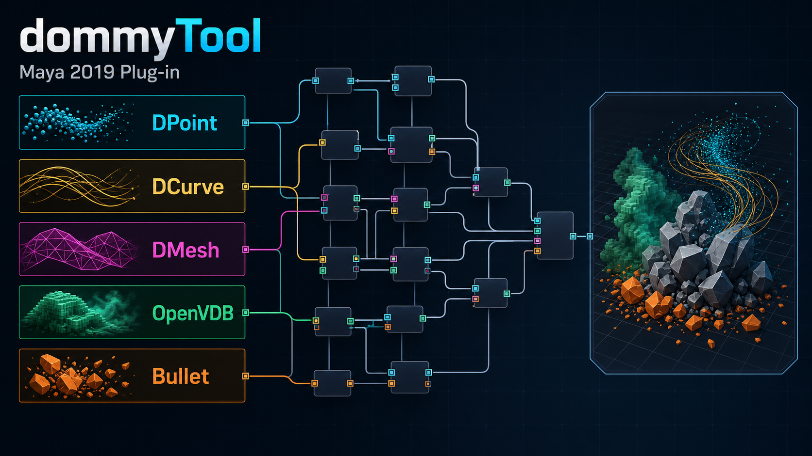

# dommyTool

dommyTool is a collection of Autodesk Maya plug-ins and related tools developed primarily between 2015 and 2019. It brings together custom nodes, commands, viewport extensions, and Python utilities for procedural geometry, volume processing, and simulation.

## Video

[Watch on YouTube](https://youtu.be/WwmTf652SwI)

## Why I built it

The project began before Maya offered Bifrost Graph as a general-purpose procedural environment. At the time, I wanted to explore whether Maya could support a workflow closer to Houdini: instead of creating each asset through a fixed sequence of manual operations, reusable components could be connected to construct geometry and effects procedurally.

The goal was to build an interconnected system of Maya dependency-graph nodes that could generate, transform, and exchange large volumes of data. The resulting toolset grew to cover point clouds, curves, polygon meshes, OpenVDB volumes, particle workflows, and Bullet-based dynamics.

The C++ code contains the procedural nodes, commands, custom data types, and viewport overrides. The accompanying DPyTools Python package provides Maya menus, scene utilities, rigging tools, and workflow helpers.

## Development history

I continued developing dommyTool until around 2019. Development has since stopped, and I eventually moved away from 3D software development altogether. I no longer maintain the plug-in as an active product and do not currently have the original Maya 2019 development environment required to rebuild and run the complete system.

This repository contains the source code for that collection and preserves the procedural ideas behind it. It is an inactive source archive, not a supported or production-ready Maya package.

## Archive status

- Original target: Autodesk Maya 2019
- Main development period: approximately 2015–2019
- Current development status: inactive
- Complete Maya 2019 build and runtime verification: unavailable
- Repository format: plug-in and tool source archive

Portable tests and source checks are included, but they do not establish compatibility with the original Maya host or binary dependency environment. See [Verification scope and limits](docs/MAYA_2019_VALIDATION.md).

## Repository map

| Directory | What you will find |
| --- | --- |
| [`src/`](src/) | C++ Maya plug-in code: shared data and algorithms, procedural nodes, commands, and optional integrations. |
| [`python/`](python/) | The `DPyTools` package, Maya menus, scene utilities, rigging tools, and pipeline helpers. |
| [`third_party/`](third_party/) | Vendored libraries and their license texts, separate from project-owned code. |
| [`tests/`](tests/) | Maya-independent regression tests, source contracts, and lightweight test-only SDK substitutes. |
| [`cmake/`](cmake/) | Optional full-source and link-check configuration for an externally supplied Maya SDK stack. |
| [`config/`](config/) | The explicit C++ source manifest, Maya module template, and example SDK build environment. |
| [`docs/`](docs/) | Architecture, dependency, compatibility, and verification notes, plus the overview image. |
| [`tools/`](tools/) | Dependency-source fetching, source-manifest inspection, and validation scripts. |
| [`.github/`](.github/) | CI workflows and dependency-update configuration. |

Within `src/`, `plugin/` owns registration and lifecycle, `core/` contains shared infrastructure, `modules/` groups nodes by feature family, `commands/` contains Maya commands, and `integrations/` holds external renderer and simulation adapters.

Within `python/DPyTools/`, the main layers are `core/` for host-independent helpers, `scene/` for Maya adapters, `features/` for tool implementations, `pipeline/` for workflow tools, and `ui/` for interfaces. Historical import paths remain as compatibility entry points.

The original Maya-facing identifiers and historical module names are intentionally preserved. [Repository architecture](docs/ARCHITECTURE.md) explains the subdirectories and compatibility boundaries in more detail.

## License

Original dommyTool code is released under the [MIT License](LICENSE). Third-party source and its locally modified derivatives retain their respective licenses, including licensed adapters located under `src/`. This repository contains multiple licenses; see [Third-party notices](THIRD_PARTY_NOTICES.md) for component-level attribution and scope.
